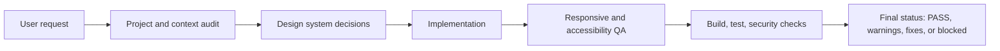

# DesignForge

> A professional AI skill for designing, building, and QA-checking modern web interfaces with senior product design discipline.

[](https://github.com/Zaheer-verse/DesignForge/actions/workflows/ci.yml)
[](LICENSE)

DesignForge is a Codex/AI-agent skill that turns web UI requests into a structured design-engineering workflow. It helps an agent move from discovery to implementation, responsive QA, accessibility review, performance checks, security review, and deployment readiness without falling into generic template output.

## Quick Navigation

- [Why This Exists](#why-this-exists)
- [What Makes It Different](#what-makes-it-different)
- [Quick Start](#quick-start)
- [Installation](#installation)
- [Examples](#examples)
- [Validation](#validation)
- [Project Structure](#project-structure)
- [Contributing](#contributing)

Repository: [github.com/Zaheer-verse/DesignForge](https://github.com/Zaheer-verse/DesignForge)

## Why This Exists

AI-generated web interfaces often look plausible on the first pass but fail under real product constraints: weak hierarchy, generic sections, inaccessible controls, brittle responsive behavior, decorative motion, and missing QA. DesignForge gives an AI coding agent a clear operating model for high-quality frontend work.

It is for developers, maintainers, designers, and AI-tool users who want web experiences that are usable, distinctive, accessible, responsive, performant, secure, and maintainable.

## What Makes It Different

DesignForge is not a component library and does not prescribe one visual style. It is an instruction system and reference corpus for design decisions. It emphasizes:

- Design reasoning before visual effects
- Mobile-first layout and responsive verification
- Accessibility and keyboard support as release gates
- Purposeful motion with reduced-motion handling
- Conservative dependency choices based on the existing project
- Security, testing, and deployment readiness as part of UI work

## Features

| Area | What DesignForge Guides |
| --- | --- |
| Discovery | Audience, product context, user goals, content hierarchy, technical constraints |
| Design systems | Typography, color, spacing, layout, motion, component state rules |
| Page patterns | Landing pages, dashboards, auth, documentation, e-commerce, settings, AI chat, search |
| Accessibility | Semantic HTML, focus states, keyboard navigation, contrast, reduced motion |
| Responsive QA | 320px, 768px, 1024px, and 1440px+ checks |
| 3D and motion | CSS 3D, Three.js guidance, performance budgets, graceful fallbacks |
| Release quality | Build validation, tests, security review, final QA classification |

## Quick Start

Use DesignForge when asking an AI coding agent to create or improve web UI:

```text
Use DesignForge to redesign this dashboard. Keep the existing React stack, improve hierarchy and responsiveness, add accessible focus states, then run the available build and test checks.
```

The skill will guide the agent to inspect the codebase first, choose design decisions that fit the product, implement within the existing stack, and report what passed, warned, failed, or was not run.

## Installation

### Codex Skills Directory

Copy this repository into your Codex skills directory:

```bash
mkdir -p "$CODEX_HOME/skills"
cp -R DesignForge "$CODEX_HOME/skills/designforge"
```

If `CODEX_HOME` is not set, use the skills directory supported by your local Codex installation.

### Other AI Coding Agents

1. Add [SKILL.md](SKILL.md) to the agent's skill or instruction system.
2. Keep the [references](references) directory available as supporting material.
3. Use the [examples](examples) and [templates](templates) directories for realistic task framing.

DesignForge does not require npm, Python packages, or a build step to use the skill itself.

## Basic Usage

Simple request:

```text
Use DesignForge to create a responsive landing page for a privacy-focused analytics product.
```

Advanced request:

```text
Use DesignForge to rebuild this e-commerce product detail page. Preserve the existing routing and data model, create a stronger product hierarchy, support keyboard navigation for the gallery, respect prefers-reduced-motion, and verify the result at mobile, tablet, and desktop widths.
```

## How It Works



DesignForge expects the agent to work inside the target project's actual framework and constraints. It should not install libraries, invent assets, or claim validation that was not performed.

## Configuration

DesignForge is configured through instruction and context rather than runtime settings.

| Option | How to Specify It | Default |
| --- | --- | --- |
| Design maturity | Ask for clean, polished, premium, advanced, or art-directed output | Professional/polished |
| Risk tolerance | Ask for conservative or experimental decisions | Conservative |
| Stack constraints | Tell the agent which framework, CSS system, and dependencies are allowed | Existing project stack |
| QA depth | Ask for specific checks such as responsive screenshots, keyboard testing, or Lighthouse | Available local checks |
| Output format | Ask for implementation only, audit report, design spec, or review | Implementation plus concise report |

## Examples

- [E-commerce product page](examples/ecommerce.md)
- [Landing page request](examples/landing-page.md)
- [Dashboard redesign request](examples/dashboard.md)
- [AI app interface request](examples/ai-app.md)

These examples are representative prompts and design breakdowns. They do not claim that a specific generated UI was executed unless a validation result is shown.

## Advanced Usage

Use DesignForge for:

- Production-readiness reviews before deployment
- Redesigning generic AI-generated interfaces
- Creating page specs before implementation
- Auditing accessibility and responsive behavior
- Deciding when 3D, motion, or visual effects are justified
- Establishing repeatable QA expectations for AI-assisted frontend work

## Validation

This repository includes a validation script for the skill corpus:

```bash
python scripts/validate_repository.py
```

Run the unittest wrapper:

```bash
python -m unittest discover -s tests
```

These checks validate repository documentation quality, internal links, required files, frontmatter, placeholder URLs, and secret-like content. They do not evaluate the subjective visual quality of AI-generated UI.

## Troubleshooting

| Problem | What To Do |
| --- | --- |
| The agent ignores the skill | Confirm `SKILL.md` is installed in the correct skills directory and the skill name is `designforge`. |
| Output looks generic | Provide product context, audience, brand constraints, and ask for an explicit DesignForge discovery pass before implementation. |
| The agent claims tests passed without evidence | Ask it to list exact commands run and mark unavailable checks as `NOT RUN`. |
| 3D or motion hurts performance | Use the 3D and animation references, reduce mobile complexity, and require `prefers-reduced-motion` fallbacks. |
| Installation path differs | Follow your AI tool's skill-loading convention and keep this repository intact as the skill directory. |

More help: [Troubleshooting Guide](docs/troubleshooting/TROUBLESHOOTING.md).

## Project Structure

```text
DesignForge/
├── SKILL.md
├── README.md
├── LICENSE
├── CHANGELOG.md
├── CONTRIBUTING.md
├── CODE_OF_CONDUCT.md
├── SECURITY.md
├── docs/
├── examples/
├── references/
├── scripts/
├── templates/
└── tests/
```

Important areas:

- [SKILL.md](SKILL.md): primary skill instructions
- [references](references): detailed design, accessibility, responsive, motion, and QA guidance
- [templates](templates): reusable planning and review templates
- [examples](examples): realistic usage examples
- [scripts/validate_repository.py](scripts/validate_repository.py): repository validation checks

## Development

1. Edit the skill, references, docs, examples, or templates.
2. Keep claims specific to actual project behavior.
3. Run:

```bash
python scripts/validate_repository.py
python -m unittest discover -s tests
```

4. Update [CHANGELOG.md](CHANGELOG.md) for user-facing changes.

## Contributing

Contributions are welcome when they improve the skill's clarity, correctness, examples, or validation. Read [CONTRIBUTING.md](CONTRIBUTING.md) before opening a pull request.

## Security

Do not commit API keys, tokens, private keys, credentials, local `.env` files, or private customer/project data. See [SECURITY.md](SECURITY.md) for reporting guidance.

## Roadmap

- Add more framework-specific examples with clearly marked assumptions
- Expand validation fixtures for instruction adherence reviews
- Add optional Markdown lint integration when a package manager is introduced
- Improve docs for design-review workflows across multiple AI coding tools

## FAQ

### Is DesignForge a UI kit?

No. It is an AI skill and design-engineering methodology, not a component package.

### Does it require a specific framework?

No. The skill instructs the agent to inspect and respect the existing project stack.

### Does it generate images or 3D assets?

No. It provides guidance for when assets, Three.js, React Three Fiber, CSS 3D, or fallbacks are appropriate.

### Can it replace human design review?

No. It raises the floor for AI-assisted UI work, but brand-critical projects still benefit from human product and visual design judgment.

## License

DesignForge is released under the [MIT License](LICENSE).

## Acknowledgements

DesignForge is built from established web design, accessibility, frontend engineering, and open-source maintenance practices.

**Design with purpose. Build with quality. Ship with confidence.**
