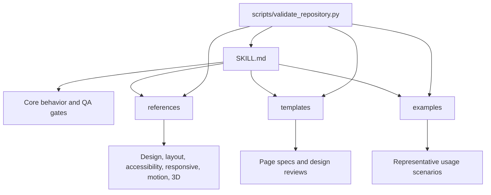

# Architecture

DesignForge is organized as a skill corpus.

## Core File

`SKILL.md` defines the role, workflow, anti-patterns, validation gate, and final quality classification.

## Supporting References

The `references/` directory gives deeper guidance for specialized areas. These files are intentionally separate so the main skill stays readable.

## Templates

Templates support repeatable planning and QA:

- `templates/page-spec.md`
- `templates/design-review.md`

## Examples

Examples show realistic prompts and design breakdowns. They should stay honest: do not imply a UI was built or tested unless that happened.

## Validation

The local validator checks repository integrity. It is designed to run in CI without external dependencies.
